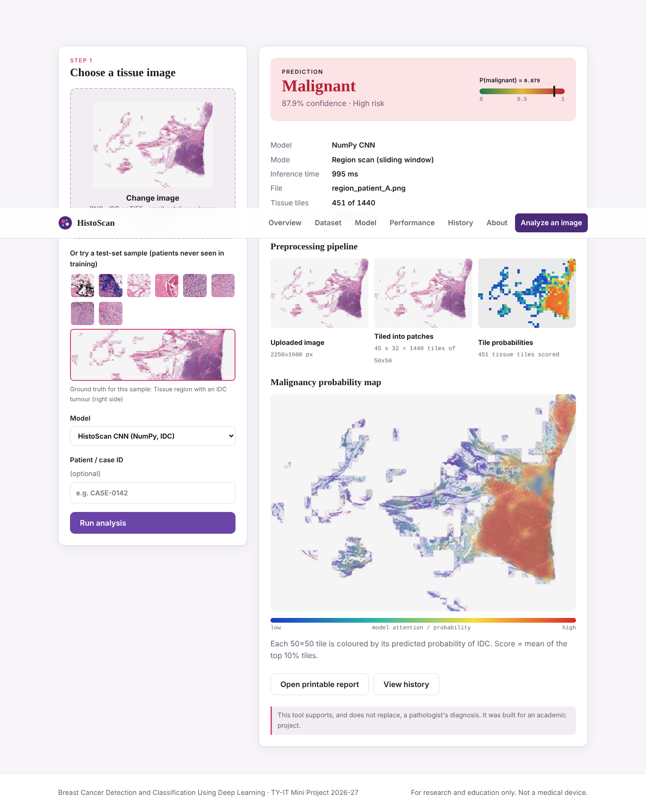

# HistoScan: Breast Cancer Detection and Classification Using Deep Learning

TY-IT Mini Project (Semester V, 2026-27) · K J Somaiya Institute of Technology
Team: Harsh Siroya (41), Jinay Shah (77), Diyaan Singhvi (39), Yash Rana (76) · Guide: Dr. Reena Lokare

HistoScan is a web application that classifies H&E-stained breast histopathology images as **benign** or **malignant** with a Convolutional Neural Network. It shows **where** the model looked (Grad-CAM) and can scan a larger tissue region tile by tile to build a malignancy probability map.



Demo video: [docs/demo.mp4](docs/demo.mp4) · Viva prep: [docs/VIVA_GUIDE.md](docs/VIVA_GUIDE.md)

## Results (held-out test set: 2,818 patches from 14 patients never seen in training)

| Accuracy | Precision | Recall (sensitivity) | Specificity | F1 | ROC-AUC |
|---|---|---|---|---|---|
| 79.2% | 74.5% | 82.2% | 76.7% | 0.782 | 0.871 |

For reference, published CNNs on the same IDC dataset report F1 of 0.718 (Cruz-Roa et al., 2014) and 0.765 (Janowczyk & Madabhushi, 2016).

## Run it on your computer (about 2 minutes)

Requirements: **Python 3.9 or newer**. TensorFlow is **not** needed: the bundled CNN runs on NumPy.

**macOS / Linux**
```bash
git clone https://github.com/jinayrshah/breastcancercnn.git
cd breastcancercnn
./run.sh
```

**Windows**
```bat
git clone https://github.com/jinayrshah/breastcancercnn.git
cd breastcancercnn
run.bat
```

Then open **http://127.0.0.1:5000** in your browser.

Manual alternative: `pip install -r requirements.txt` and then `python app.py`.

## Pages

| Page | What it shows |
|---|---|
| Overview | Problem, objectives, pipeline and headline metrics |
| Analyze | Upload an image or pick a test sample. Shows the prediction, confidence, preprocessing steps, Grad-CAM or the region probability map, and a printable report |
| Dataset | Datasets used, patient-level split, example patches |
| Model | CNN architecture, layer table, training setup, how Grad-CAM works |
| Performance | Metrics, confusion matrix, ROC curve, training curves, comparison with literature |
| History | Every analysis saved in SQLite, with a printable report for each |
| About | Team, guide, tech stack, future work, references |

REST API: `POST /api/predict` (form fields `image` or `sample`, `backend`) returns JSON.

## Demo images

Everything in `static/samples/` comes from **test-set patients** (never used in training):

- `patch_1_benign.png` to `patch_4_benign.png`: benign tissue patches
- `patch_5_idc.png` to `patch_8_idc.png`: malignant (invasive ductal carcinoma) patches
- `region_patient_A.png`: a 2250×1600 tissue region rebuilt from one patient's patches, with a tumour on the right. Upload it to see the region-scan heatmap.

## Project structure

```
app.py                      Flask app: pages, REST API, SQLite history
bcnet/npcnn.py              CNN written from scratch in NumPy: Conv, ReLU, MaxPool, Dense, Dropout,
                            backprop, Adam, Grad-CAM
bcnet/predictor.py          Preprocessing, patch and region-scan inference, heatmaps, Keras backend
bcnet/metrics.py            Accuracy, precision, recall, F1, ROC-AUC, plots
models/idc_cnn.npz          Trained weights (171,169 parameters)
models/idc_metrics.json     Test-set metrics and training history
training/train_numpy_cnn.py Training script (patient-level split, augmentation, early stopping)
training/patient_split.txt  The exact train/val/test patient split used
training/keras/             TensorFlow/Keras pipeline for BreakHis (custom CNN, ResNet50, VGG16)
notebooks/                  Google Colab notebook for the Keras/BreakHis pipeline
templates/, static/         Frontend (HTML, CSS, JavaScript)
docs/VIVA_GUIDE.md          Presentation script and likely viva questions with answers
```

## Model

```
Input 48x48x3 -> [Conv3x3(16) ReLU MaxPool] -> [Conv3x3(32) ReLU MaxPool] -> [Conv3x3(64) ReLU MaxPool]
-> Flatten -> Dense(64) ReLU Dropout(0.5) -> Dense(1) Sigmoid = P(malignant)
```

Training: binary cross-entropy, Adam (lr 1e-3, halved every 4 epochs), batch 64, flips and 90° rotations for augmentation, early stopping on validation AUC (best epoch 11). The data is split 70/15/15 **by patient**, so there is no leakage between train and test.

## Retraining

1. Download the IDC dataset ("Breast Histopathology Images" on Kaggle).
2. Run:
```bash
python training/train_numpy_cnn.py --data <path>/IDC_regular_ps50_idx5 --split training/patient_split.txt
```
This takes about 10 minutes on a laptop CPU.

**Keras / BreakHis model (optional):** train it with `notebooks/BreakHis_Keras_Colab.ipynb` on Colab. Then copy `breast_cnn.keras` into `models/` and run `pip install tensorflow`. It will appear as a second model on the Analyze page.

## Datasets

- IDC: Janowczyk A., Madabhushi A., *J. Pathology Informatics*, 2016. 277,524 patches of 50×50 px from 162 whole-slide images.
- BreakHis: Spanhol F. A. et al., *IEEE TBME*, 2016. 7,909 images from 82 patients.

> This is an academic prototype. It is not a medical device and must not be used for diagnosis.
